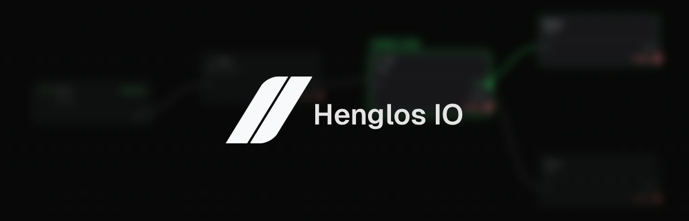

<p align="center">
  
</p>

<p align="center"><b>Program microcontrollers as visual workflows.</b></p>

---

Henglos IO lets you wire sensors, actuators and logic on a visual canvas, run it on a real board,
and step through it action by action — with every value on screen. Boards run
[MicroPython](https://micropython.org); every board and component is a package you can install,
or write yourself. It's self-hosted: the whole platform runs on your own machine or server.

> [!WARNING]
> Henglos IO is in **beta** — things may still change between versions.

## Quick start

You need [Docker](https://www.docker.com) and a board (an ESP32 to start with).

**1. Start Henglos IO**, using the installation script:

```bash
curl -fsSL https://get.henglos.com/henglos-io | sh
```

It downloads the deployment files into `./henglos`, generates the secrets and starts everything.
Or deploy manually with [Docker](https://docs.henglos.com/quick-started)

Open `http://hio.localhost` — the first time, it asks you to create your account.

**2. Connect your board**, from the computer it's plugged into:

```bash
npm install -g @henglosio/cli
hio driver configure http://localhost
hio driver login <pair-token> "My bench"     # the token from the studio's Drivers page
hio driver start
```

**3. Create a workflow** in the studio, pick your board and its port, and press **Run**.

## License

[Sustainable Use License](LICENSE) — fair-code: free to use and modify for your own or your
company's internal use.
